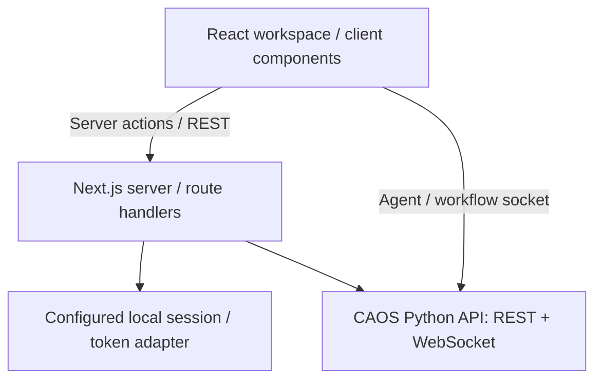
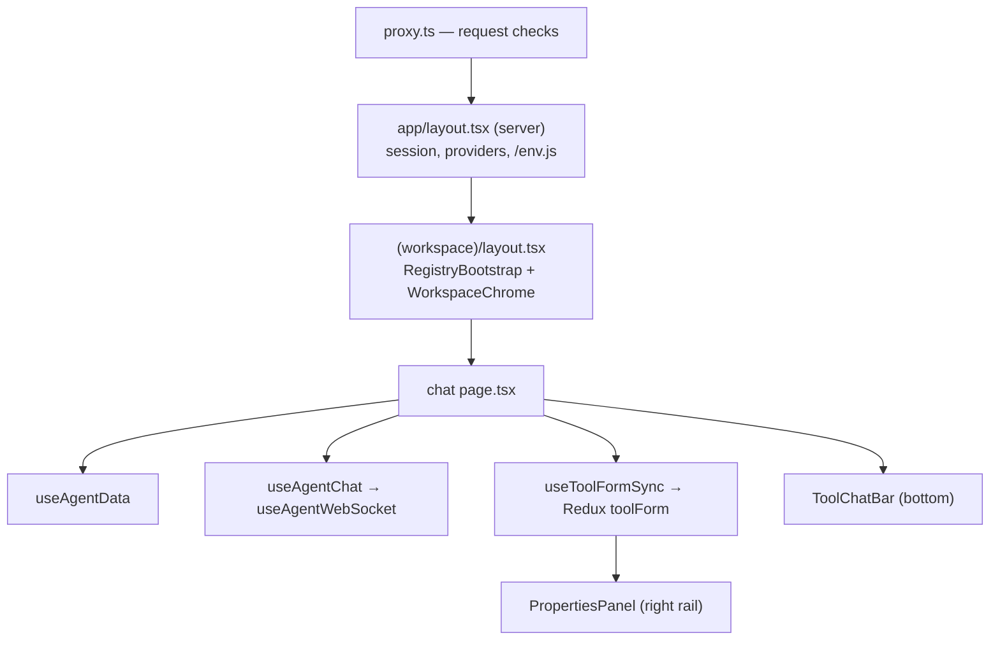

# 02 — Architecture & repo layout

## The system around this repo



The exact token handoff for REST and WebSockets depends on the local-session implementation.
Verify the corresponding server action, token helper, and socket connector in code.

## The four surfaces

The app is four screens' worth of product, and the folder structure maps onto them almost exactly.

| Surface              | Route                                             | Who              | Lives in                         |
| -------------------- | ------------------------------------------------- | ---------------- | -------------------------------- |
| Agent list / home    | `/`                                               | anyone signed in | `app/(workspace)/`               |
| **Chat**             | `/chat/[system_name]/[agent_id]`                  | user or admin    | `app/(workspace)/chat/`          |
| **Orchestration**    | `/orchestration/[system_name]/[agent_id]`         | user or admin    | `app/(workspace)/orchestration/` |
| **Agent builder**    | `/agents/new`, `/agents/[id]/edit`                | admin            | `app/agents/`                    |
| **Workflow builder** | `/workflows`, `/workflows/new`, `/workflows/[id]` | admin            | `app/workflows/`                 |

Chat and orchestration are two _workspaces_ for two kinds of agent. Which one an agent opens into is
decided in one place, `shared/lib/workspace/workspaceResolver.ts`, keyed off the agent's `type`
field. It also declares which side panels each workspace gets. If you ever find yourself writing
`pathname.startsWith("/chat/")` somewhere, that resolver is the thing you actually wanted.

Use the current route table and `next.config.mjs` to check redirects before relying on an alias.

## Real folder layout

The following is an orientation map of the client architecture. Check the working tree for exact names.

```
src/
├── app/                              # App Router — routes and route-owned code
│   ├── layout.tsx                    # root: providers, theme, local session, /env.js
│   ├── RegistryBootstrap.tsx         # loads backend registries into Redux
│   ├── (workspace)/                  # route group: everything with the workspace chrome
│   │   ├── layout.tsx                # chrome + registry bootstrap + properties panel
│   │   ├── page.tsx                  # "/" landing / agent explorer
│   │   ├── _components/  _hooks/     # workspace-wide bits
│   │   ├── _tool-form/               # ★ the tool UI engine (chapter 05)
│   │   ├── chat/                     # ★ chat workspace (chapter 05)
│   │   └── orchestration/            # ★ workflow run canvas (chapter 06)
│   ├── agents/                       # agent builder wizard (chapter 07)
│   ├── workflows/                    # workflow builder + catalog (chapter 06)
│   ├── api/                          # route handlers (local/API integration as configured)
│   └── unauthorized/
├── shared/                           # cross-feature code
│   ├── api/                          # REST callers + response envelope
│   ├── auth/                         # session, token adapter, request protection, route config
│   ├── components/                   # shared UI incl. layout/ (AppShell, chrome)
│   ├── hooks/                        # useAgentList, useToast, useWorkflowList…
│   ├── lib/                          # server-actions, logger, workflow/, workspace/
│   └── websocket/                    # generic socket transport hooks
├── store/                            # Redux: index.ts, hooks.ts, selectors.ts, slices/
├── design-system/                    # globals.css, theme colors
├── providers/                        # ReduxProvider
├── mocks/                            # MSW handlers for tests
├── test-utils/                       # render helpers, fixtures, socket test tools
├── types/
└── proxy.ts                          # Next middleware entry point
```

### The folder conventions, and why they exist

**`_`-prefixed folders are private and colocated.** `app/(workspace)/chat/_hooks/useAgentChat.ts`
belongs to chat and nothing outside chat may import it. This is the main organising rule of the
repo: code lives next to the route that owns it until a second route needs it, at which point it
moves to `shared/`. You can see the trace of that migration everywhere — `websocket.types.ts` in
chat is now mostly re-exports from `shared/websocket`.

**`shared/` is the promotion target.** Anything under `shared/` is deliberately feature-agnostic and
usually pure (no React, no Redux) so it can be unit-tested in isolation. `shared/lib/workflow/` and
`shared/lib/workspace/` are the best examples: plain functions with heavy test files beside them.

**Tests sit beside their subject.** `useAgentChat.ts` and `useAgentChat.test.tsx` in the same
folder.

**`_lib` vs `_hooks` vs `_components`.** `_lib` is pure logic (parsers, graph builders,
serializers), `_hooks` is stateful React, `_components` is UI. Look at `orchestration/_lib/` —
`workflowGraph.ts` builds nodes and edges with no React Flow import at all, and `layoutAdapter.ts`
applies positions afterwards. That split is what makes the graph logic testable by asserting on sets
rather than coordinates. Copy that instinct when you add something.

## How a page gets assembled

Take `/chat/joshu-a/abc123`. In order:

1. **`src/proxy.ts` and its current request handler** apply the configured request rules and security headers. In local-session mode, do not assume a redirect-to-login flow; inspect the actual middleware and route policy.
2. **`app/layout.tsx`** (server) establishes the configured session and renders `<html>`, injects the runtime `/env.js`
   script, and wraps the tree in theme → session → Redux → tooltip providers, plus the toast
   container.
3. **`app/(workspace)/layout.tsx`** (client) wraps in `RegistryBootstrap` — which fetches the tool,
   personality, role, rulepack and agent-type registries into Redux once per session — then renders
   `WorkspaceChrome`. The chrome decides the left rail (agent list) and, for chat, hands the right
   rail the tool-form `PropertiesPanel` if the current tool declares any panel fields.
4. **`chat/[agent_system_name]/[agent_id]/page.tsx`** finally renders: it reads the route params,
   fetches the agent (`useAgentData`), opens the socket and owns the conversation (`useAgentChat`),
   bridges the selected tool's UI into Redux (`useToolFormSync`), and renders the message list plus
   `ToolChatBar`.



## The app chrome

`shared/components/layout/` holds the shell:

- **`AppShell`** — the three-column frame: left sidebar, working area, right sidebar, with header
  and footer slots for the left rail.
- **`WorkspaceChrome`** — the opinionated wrapper the surfaces actually use. It resolves the current
  workspace from the pathname, decides which panels to show, puts the agent list in the left rail
  and the profile menu in its footer, and caps the reading width for chat only.
- **`GlobalPanel`** — the left rail's contents: the agent list, so switching agents is one click
  from anywhere.

The workflow and agent builders sit _outside_ `(workspace)`, because a builder is a full-bleed
editor and does not want the chat chrome. They gate themselves with `BuilderAccessGate`, which shows
a readable explanation instead of a silent redirect when your roles don't allow building.

---

Next: [03 — Local session, config & runtime](03-auth-and-config.md)
