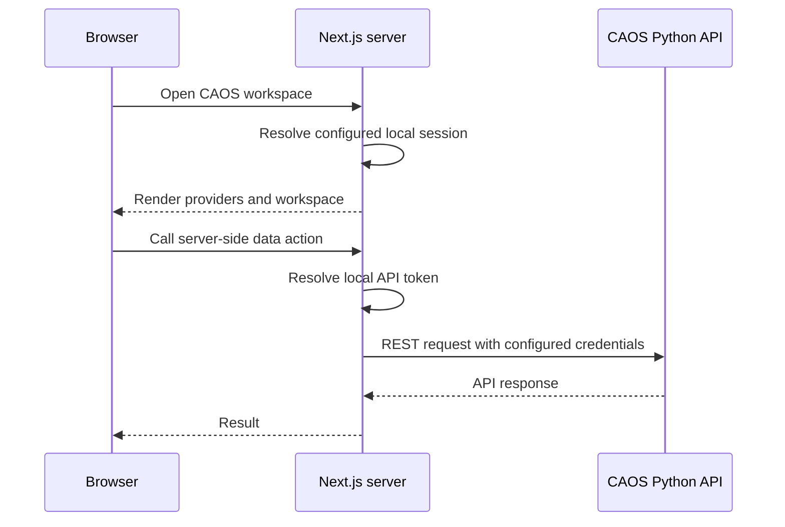

# 03 — Local session, config & runtime

## The shape of it

CAOS currently uses a **local development identity** backed by a mock JWT. There is no interactive external sign-in flow in this application. A local session still supplies identity and roles so the existing agent, workflow, and backend permission conventions continue to work.

The actual source files (`local-session.ts`, `local-token.ts`, `get-api-token.ts`, and `server-actions.ts`, where implemented) are the source of truth for token creation, access, and forwarding. Verify the current file paths and exports before changing them.

## Local request flow

**Do not infer from this diagram that every local token is server-only or HttpOnly.** That depends on the chosen implementation; verify whether a given token is held server-side, in a cookie, or elsewhere. A mock JWT is development infrastructure, not a production-grade identity assertion.

## Authentication versus authorization

`useAuth()` remains the UI-facing identity/permissions interface. Existing components may use `userId`, `session`, or `canCreateAgent` to decide what to show. This is **presentation authorization**, not enforcement. The Python API must validate credentials and permissions for protected operations.

A local token should have a clear, stable development identity, explicit test roles, a deterministic way to recreate the session, and no embedded real credentials. Avoid hardcoding a long-lived signing secret into browser code.

## Getting an API token

Keep token resolution in the existing API-token abstraction (`get-api-token.ts` or equivalent) and API call logic in the current server action (`server-actions.ts` or equivalent). Do not introduce sign-in redirects as a fallback. If the token cannot be resolved, surface an actionable local configuration error rather than silently bypassing authorization.

For WebSockets, inspect the current `wsTokenFetcher.ts`, URL builder, and backend socket authentication contract. A local session does **not** automatically mean that REST and WebSocket tokens are interchangeable. Verify the actual WebSocket credential endpoint before coding against it.

## Route protection

Next.js 16 uses `src/proxy.ts` as the request interception entry point in this repository. Inspect the implementation it imports, currently under `src/shared/auth/`, before changing authorization behavior. Keep request security headers and route protection consistent with the actual local session model.

Do not add protections based on assumed roles or routes without checking `route-config.ts` and the current API role model.

## Environment configuration

There are two possible public configuration layers in the application:

1. `NEXT_PUBLIC_*` values are bundled into client code at build time.
2. `public/env.js`, where enabled by `entrypoint.sh`, is generated at container startup to supply selected runtime values.

Never put secrets, bearer tokens, signing keys, or private backend credentials in browser-visible runtime configuration. Check the actual runtime allowlist in `entrypoint.sh` and the reader in `shared/lib/publicEnv.ts`.

A backend URL used by server code may differ from the public browser URL. Check `NEXT_SERVER_BASE_URL`, `NEXT_PUBLIC_API_BASE`, `next.config.mjs` rewrites, and the deployment environment rather than assuming they have identical addresses.

## Server-side data access

`shared/lib/server-actions.ts` is the established REST gateway. Maintain its timeout, origin validation, and error handling when changing how the local token is added. Preserve the existing backend response envelope; authentication changes should not trigger a rewrite of API and widget contracts.

## Before changing auth or config

- Confirm the exact local session/token implementation and current env variable names.
- Check server/client boundaries and avoid exposing secrets.
- Verify backend token validation rather than assuming JWT shape alone is sufficient.
- Validate REST and WebSocket authentication independently.
- Keep current `useAuth()` consumers and workflow permissions working.
- Only introduce an interactive sign-in flow if it becomes an explicit product requirement.

---

Next: [04 — Data & state](04-data-and-state.md)
