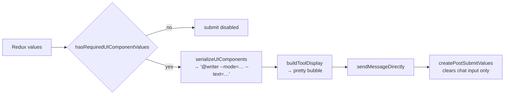

# 05 — Chat & the tool UI contract

This is the heart of the application. If you understand this chapter you can explain the product.

## The problem it solves

A CAOS tool takes structured parameters. Naively, the user would have to type

```
@writer --mode=rewrite --tone_of_voice=clear,curious --text="make this shorter"
```

Instead the client renders that command as a UI: a mode pill strip above the input, a tone
multi-select in the right-hand panel, and the text in the composer. On submit it serialises the
widgets back into exactly the string above and sends it.

The crucial constraint: **the client has no hardcoded knowledge of `writer`, or of any tool.** Every
widget on screen was described by the backend.

## The contract

Each tool in the registry carries a `ui` block:

```
ToolDefinition.ui
├── components: UIComponent[]     — composable widgets, each with render_paths
└── config
    ├── chat_input                — the composer, a first-class field (not a component)
    └── group_label_map           — display labels for panel sections
```

A `UIComponent`:

```ts
{
  id: "tone_of_voice",                        // form-state key
  type: "multiselect",                        // data type
  widget: "CheckboxGroupField",               // which React component
  group: "tone",                              // panel section
  flag_config: { flag: "--tone_of_voice", required: false },
  render_paths: ["propertiesPanel.tone"],     // where it mounts
  slot_order: 2,
  props: { label: "Tone of voice", options: [...] }
}
```

`ChatInputConfig` is deliberately _not_ a component — the composer always exists and always renders
in the same place, so it is configured (`id`, `placeholder`, `flag`, `required`, `file_upload`)
rather than composed. When it is absent, the tool has no structured input and the bar falls back to
plain free-text chat.

> `ui-widget-registry.md` at the repo root is the authoritative spec, including the full render-path
> table and the step-by-step recipes for adding a path or a widget. Read it before touching
> `ToolChatBar` or `FieldRenderer`. This chapter is the tour; that file is the law.

## Render paths

A render path is a string naming a mount point. Each location in the UI subscribes to exactly one.

| Path                                                        | Where it appears                | Rendered by                             |
| ----------------------------------------------------------- | ------------------------------- | --------------------------------------- |
| `workspace.conversationArea.inputSection.toolMode`          | pill strip above the input      | `ToolChatBar` via `SLOT_WIDGET_MAP`     |
| `workspace.conversationArea.inputSection.inputActionBar`    | left of the input action bar    | `ToolChatBar` via `SLOT_WIDGET_MAP`     |
| `workspace.conversationArea.responseCard.responseActionBar` | action strip on a response card | `ResponseBubble`, directly              |
| `propertiesPanel.<group>`                                   | right sidebar, grouped          | `DynamicFormRenderer` → `FieldRenderer` |

`useRenderPath(path, components)` (`(workspace)/_hooks/useRenderPath.ts`) does the filtering and
sorts by `slot_order`, with `null` sorting last. All the string matching lives in this one file. The
one special case: `"propertiesPanel"` matches by `startsWith`, so every `propertiesPanel.*` group
comes back together and `DynamicFormRenderer` does the grouping.

The pure function `getRenderPathComponents` is exported alongside the hook so serializers and tests
can use it outside React.

## The two widget registries

**Slot widgets** — `SLOT_WIDGET_MAP` at the top of `ToolChatBar.tsx`: `PillGroup`,
`ResponseActionBar`. Each receives `{ component, value, onChange }`.

**Panel widgets** — `FieldRenderer.tsx`: `TextField`, `TextArea`, `NumberField`, `SelectField`,
`CheckboxGroupField`, `JsonField`, `FileField`. `uiComponentToFieldConfig.ts` translates a
`UIComponent` into the typed `FieldConfig` a field component expects.

There is one documented exception: `ResponseActionBar` on the `responseActionBar` path is rendered
directly by `ResponseBubble` rather than through the map, because its `onChange` has to set two
values at once (the mode field _and_ the chat input pre-fill), which the generic helper cannot
express.

Two field types use a string smuggling trick worth knowing:

- **`JsonField`** keeps its value as raw JSON _text_, so it needs no change to `FormValues` or the
  serializer; the backend parses it back into a dict.
- **`FileField`** uploads eagerly on pick and keeps the returned opaque `file_id` string as its
  value, for the same reason.

## Form state

All widget values live in Redux, in `toolFormSlice`, keyed by `UIComponent.id` and
`chatInputConfig.id`. Access via `useToolForm()`:

```ts
const { values, setValue, uiComponents, groupLabelMap, chatInputConfig } = useToolForm();
```

> **Never keep tool-form values in component state.** The composer and the properties panel are in
> different parts of the React tree — the panel is rendered by the workspace _layout_, the composer
> by the _page_ — so a shared store is the only thing that can hold them together.

**`useToolFormSync`** is the bridge. The chat page calls it with the selected tool's `ui` data and
`sendMessageDirectly`. It:

1. dispatches `initToolForm` whenever the selected tool changes, resetting all values;
2. mirrors `isThinking` into the slice so the panel can disable itself;
3. dispatches `clearToolForm` on unmount;
4. returns `submit` and `submitPartial`.

Note the ref-mirroring of `values`, `uiComponents` and the send function at the top of that file.
The submit callbacks need the newest state but must not be re-created on every keystroke — this is
the pattern from chapter 01.

## Submit



`uiComponentSerializer.ts` is small and worth reading end to end:

- Emits `@<toolKey>` first — **a tool only fires when the message contains its key prefixed with
  `@`**.
- Then one `--flag=value` per component that has a `flag_config` and a non-empty value, in component
  order, with the chat input last. Order is cosmetic; the backend parses by flag name.
- Arrays join with commas; values containing whitespace or quotes get wrapped and escaped.
- The mode pill is not special — it is a `--mode` flag like any other.

Flag naming convention is `--snake_case`.

**After submit, only the chat input is cleared.** Mode and panel fields persist, because you usually
want to send another message with the same settings. That rule lives in `createPostSubmitValues`.

`buildToolDisplay` produces the `ToolDisplayPayload` the user's own bubble renders: the prompt as
the body, and the flags as collapsed detail (`ToolSettingsDisclosure`). `parseToolCommand.ts` does
the reverse for messages that arrive as raw command text.

## The chat page, top to bottom

`app/(workspace)/chat/[agent_system_name]/[agent_id]/page.tsx` owns the screen and delegates
everything real to hooks:

| Hook              | Responsibility                                                               |
| ----------------- | ---------------------------------------------------------------------------- |
| `useAgentData`    | Fetch the agent; join its `tools` against the registry into `EnrichedTool[]` |
| `useAgentChat`    | The conversation: socket, message list, send paths, thinking state           |
| `useChatMessages` | The message array and its mutations                                          |
| `useToolFormSync` | Bridge the selected tool's UI into Redux                                     |
| `useFileUpload`   | Attachments                                                                  |

`useAgentData` is where the registry join happens: the agent stores tool _keys_, and each key is
looked up in `toolsSlice` to produce an `EnrichedTool` carrying `ui`, `uiGroupLabelMap`,
`uiChatInput` and `supports`. The page then pre-selects a tool based on the agent's role
(`defaultToolKeyForRole`), once, so dismissing it does not immediately re-select it.

### `useAgentChat`

The single interesting thing about it is that **every send path funnels through one `performSend`**,
which sends over the socket, appends the user's bubble with the right attachment metadata, and flips
`isThinking` on. `sendMessage` (from the input), `sendMessageDirectly` (from the tool form) and
`sendMessageWithFiles` are thin wrappers. Incoming frames flip `isThinking` back off.

It also handles workflow pauses: if an incoming frame parses as a `PAUSED` run snapshot, the agent
message gets a `workflow_pause` widget attached, and answering it sends an `encodeResume(...)`
command back down the same socket.

### Rendering a turn

`renderAgentBody` in the page chooses exactly one of three shapes, deliberately not layered:

1. a **registered widget** (from `widgetRegistry`) replaces the text bubble entirely;
2. a **workflow pause** renders the text _plus_ the pause widget;
3. everything else is text alone.

`widgetRegistry.ts` maps a widget type to a component — currently just `green_claim`. That is the
extension point for a rich, tool-specific result view.

Incoming payloads are messy, and `messageParser.ts` is where that mess is absorbed:
`pickPayloadFromWS` digs through `response`/`message`/`result`/`data` wrappers, and
`extractReplyText` walks `renderables` (`text`, `markdown`, `image`, `link`, `json`), `raw`,
`combined` and image arrays to find something displayable. It is defensive by necessity — don't
"clean it up" without a backend contract to clean it up against.

Two shapes of the same contract are accepted per renderable: the payload under `value`
(`{kind: "text", value: "<markdown>"}`, `{kind: "image", value: {url, mime?, alt_text?}}`) and the
older per-kind field (`text`, `markdown`, `href`, `src`). An image `value.url` is always directly
renderable — an HTTP URL or a `data:` URI, never raw base64 — so it joins the flattened text and
`MessageBubble` picks it up as an image line.

A tool result is `{answer, data, images, success, error}` with the optional keys **omitted, not
null**. Everything a tool returns beyond `answer` sits under `data`, which is why
`extractWidgetData` probes `message.result.data` before the older `message.data`.

## Adding something

**A new panel widget:** add the type to `WidgetType` in `toolForm.types.ts`, add the props
interface, build the component under `_tool-form/components/fields/`, register it in
`FieldRenderer`, and teach `uiComponentToFieldConfig` how to map it. Then tell the backend the
widget name.

**A new slot widget:** build it with `{ component, value, onChange }` props and add it to
`SLOT_WIDGET_MAP`.

**A new render path:** add the string to `RenderPath`, call `useRenderPath("your.path", components)`
where it should mount, tell the backend.

**A new result widget:** build it with `WidgetProps` and add it to `widgetRegistry`.

In all four cases the frontend change is a registration, not a branch. If you find yourself writing
`if (toolKey === "...")` in a component, stop — that is what `ui` blocks and `toolKeys.ts` exist to
prevent.

---

Next: [06 — Workflows & orchestration](06-workflows-and-orchestration.md)
