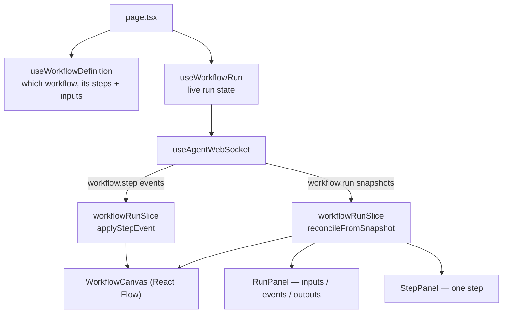

# 06 — Workflows & orchestration

Two surfaces, one domain model:

- **Orchestration** (`app/(workspace)/orchestration/`) — _running_ a workflow and watching it, on a
  read-only canvas. For users.
- **Builder** (`app/workflows/`) — _authoring_ a workflow on an editable canvas. For admins.

The shared vocabulary lives in `shared/lib/workflow/`, which is pure and heavily tested.

## The domain model

A **workflow** is a named, versioned definition of steps. A **step** has an `id`, a `type` (`tool` |
`pause` | `set` | `wait_event` | `end`), optionally a `command` (`@writer --mode=…`), a `save_as`
state key, and dependency links (`depends_on` / `next`).

A **run** is one execution. Runs have a `RunStatus` (`RUNNING`, `PAUSED`, `COMPLETED`, `FAILED`,
`CANCELLED`) and each step has a `StepStatus` (the same set plus `PENDING`, `SKIPPED`).

**References** are how data moves between steps: `${inputs.<key>}` and `${outputs.<stepId>.<key>}`
inside a command. The grammar lives in `shared/lib/workflow/references.ts` and both surfaces use it
— the builder to check a reference resolves, the run page to show what a step actually received.

**Declared outputs** are the typed values a tool promises (`ToolOutput` in `toolsSlice`), and their
resolved instances in a run (`DeclaredOutput` in `workflow.types.ts`). Images are special: a
`DeclaredImageOutput` carries _indexes_ into the payload's `images` array rather than repeating a
base64 data URI on every image step.

## Commands, again

There is no workflow REST API for running things. A run is driven by the same `@`-command channel
chat uses, encoded by `shared/lib/workflow/workflowCommand.ts`:

```ts
encodeStart(key, inputs)  // @workflow --op=start --workflow_key=k --inputs=<urlencoded json>
encodeResume({...})       // @workflow --op=resume --run_id=… --pause_payload=<urlencoded json>
encodeGet(runId)          // @workflow --op=get --run_id=…
encodeCancel(runId, key)  // @workflow --op=cancel --run_id=… --workflow_key=…
```

That is why the orchestration workspace reuses `useAgentWebSocket` unchanged: it is speaking to an
orchestration _agent_ over the ordinary chat socket.

## The run workspace



### Two streams, one truth

This is the design idea worth remembering. Run state is reconstructed from **two independent
streams**:

- **`workflow.step` events** — fast, incremental, and possibly lossy. Handled by `applyStepEvent`.
- **`workflow.run` snapshots** — the authoritative full picture, returned by start / resume / get.
  Handled by `reconcileFromSnapshot`.

**The snapshot always wins**, so the canvas self-heals even if an event was dropped.
`useWorkflowRun` tries the step-event parser _first_, because a step status like `COMPLETED` is also
a valid run status and would otherwise be misread as a snapshot.

The reducers in `store/slices/workflowRun/workflowRunSlice.ts` are the most carefully written code
in the repo, and the comments explain why each guard exists. A few that will save you confusion:

- **`abandonedRunId`** — when you start a fresh run, `runId` is briefly null while awaiting the
  first snapshot. Without retaining the abandoned id, a late event from the previous run would
  reclaim the slice and lock the UI onto a dead run.
- **`outputOrder`** — a separate array rather than relying on key insertion order, because
  `reconcileFromSnapshot` rebuilds `stepOutputs` wholesale and a reload would silently degrade
  arrival order into snapshot order.
- **`events`** — the chronological log is _derived on the client_; the backend has no event feed.
  `ts` is arrival time, not backend time. Capped at 500 entries.
- Log lines are attributed to a step only when **exactly one** step is running; with parallel steps
  or none, the line is run-scoped. That is `inferredStep: true`.

### Persistence and reattach

`runIdStorage.ts` (built on `scopedStorage.ts`) keeps the active run id in `localStorage`, scoped to
agent + workflow. On first connection `useWorkflowRun` sends `op=get` for a persisted id so a page
reload reattaches to a live run. A `NOT_FOUND` reply for the _current_ run clears the stored id and
resets — guarded on identity so a late NOT_FOUND for a stale id cannot wipe a fresh run.

### The canvas

`orchestration/_lib/` is a clean pipeline, and it is the best example in the repo of separating pure
logic from rendering:

1. **`parseWorkflowDefinition.ts`** — pull the definition and declared inputs out of the API
   payload.
2. **`workflowGraph.ts`** — turn steps into nodes and edges. No React Flow import, no coordinates.
   The edge rules mirror the backend: explicit `next`, explicit `depends_on`, and in sequential mode
   an implied edge from the previous step so a bare list renders as a chain.
3. **`layoutAdapter.ts`** — apply positions with dagre, behind a `LayoutEngine` interface so the
   engine can be swapped. Positions are recomputed from topology, never persisted.
4. **`WorkflowCanvas.tsx`** — React Flow renders it, injecting live `status` and `elapsedMs` into
   each node's data.

Because step 2 has no coordinates in it, its tests assert on node and edge _sets_. Keep it that way.

### The side panel

Selecting a node changes the panel's **scope**, not the page's mode — the canvas keeps updating
underneath. `RunPanel` is tabbed (inputs / events / outputs) and `useRunPanelTab` moves the tab to
whichever one is worth reading as the run progresses. `StepPanel` shows one step.

`resolveStepInputs.ts` deserves a mention: the backend reports a step's output but never its input,
so the run page reconstructs it by parsing the step's `command` flags and resolving any `${…}`
tokens against the run's inputs and prior outputs. That is the difference between reading a
definition and debugging a run. It is pure and total — an unresolvable reference is reported as
unresolved rather than rendered blank.

A pause gate scopes the panel to its step on arrival and releases it once answered (`PauseForm`).

## The builder

`app/workflows/` — catalog at `/workflows`, editor at `/workflows/new` and `/workflows/[id]`. Both
sit behind `BuilderAccessGate`. The editor is wrapped in `ReactFlowProvider` by
`WorkflowBuilderShell`.

`useWorkflowBuilder.ts` is the hook that owns everything: nodes, edges, name, description, declared
inputs, save state, validation issues.

### Key decisions

**React Flow owns the live graph; the definition is serialised on demand.** There is no mirrored
definition kept in sync — `buildDefinitionFromGraph` runs on save (and for the preview panel).

**Edges are authored as `depends_on` only.** An edge `A → B` means `B.depends_on += A`, and the
output is always `execution_mode: "dag"` so the engine's implicit sequential chaining never applies.
`next` is never emitted.

**A tool node's `command` string is the single source of truth.** There is no cached `values` object
on the node. Reading it for display and writing one field back both go through the same round-trip
in `nodeCommand.ts`: `collectPrefillableComponents` → `parseCommandToValues` → edit →
`serializeUIComponents`. That is the _same serializer chat uses_ — which is why a workflow step's
config panel looks and behaves like the chat properties panel. `DynamicFormRenderer` even takes a
`renderField` override so the builder can wrap each field in binding chrome without the renderer
knowing what a reference is.

**Guardrails are cheap and client-side.** `graphGuardrails.ts` blocks self-loops, duplicate edges
and cycles inline via React Flow's `isValidConnection`. Full reachability and tool-existence checks
are the backend's job, and its `422` `errors[]` are mapped back onto nodes as an error ring
(`mapIssuesToNodes`).

**Dirty tracking is a snapshot diff.** `builderSnapshot()` serialises everything that gets persisted
into a string; dirty is just `snapshot !== lastSavedSnapshot`. Node dragging and selection don't
survive serialisation, so cosmetic canvas churn cannot flip the save button.

**Dangling references are scanned, not guessed.** `references.ts` + `collectDescendants.ts` check
that every `${outputs.X.key}` names a real upstream node whose tool actually declares that key, and
that `${inputs.key}` names a declared input of the right kind (a file slot must bind a `file` input;
a command arg must not).

The palette (`BuilderPalette`) is hybrid: one entry per registered tool, plus the fixed control step
kinds from `stepKinds.ts` (`pause`, `set`, `wait_event`, `end`).

### Declared inputs

`WorkflowInputsEditor` authors the `WorkflowInputField[]` a run form will render — `key`, `label`,
`input` widget, `required`, `constraints`, `options`. Note the naming: `key` + `input`, not
`name`/`type`, mirroring the backend. Those same declarations become the run form in the
orchestration workspace via `useRunInputs`, and a `file` input's value at run start is a single
opaque `file_id`.

---

Next: [07 — Agent builder](07-agent-builder.md)
