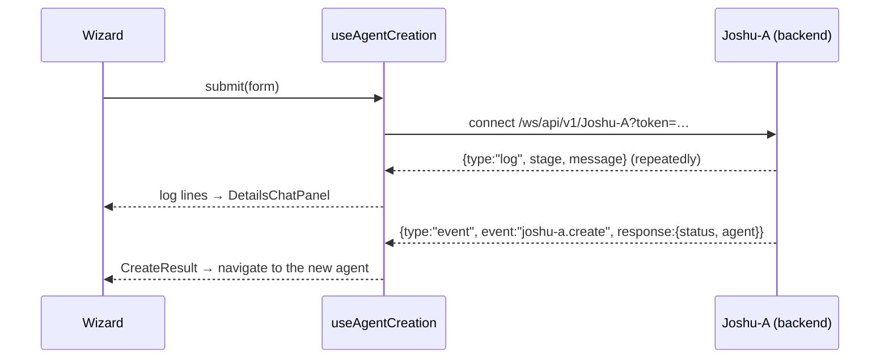

# 07 — Agent builder

`app/agents/` — `/agents/new` and `/agents/[agentId]/edit`. Admin-only, gated by `BuilderAccessGate`
and by the `/agents/` entry in `ROUTE_PROTECTIONS`.

Creating an agent is not a plain form POST. It is a **conversation with a backend agent called
Joshu-A over a WebSocket**, which streams progress lines back while it provisions. That is the one
genuinely unusual thing about this feature.

## The form layer

This is the only part of the app that uses **react-hook-form** (everything else uses Redux or local
state). `AgentFormValues` in `shared/lib/agent.types.ts` is the shape; `agentFormDefaults` in
`agentForm.tsx` is the starting state, shared by create and edit.

What an agent is made of:

| Field                 | Meaning                                               | Sourced from                   |
| --------------------- | ----------------------------------------------------- | ------------------------------ |
| `name`, `type`        | Identity. `type` is an agent-type registry key        | `agentTypeSlice`               |
| `roleRegistry`        | The agent's role                                      | `roleSlice`                    |
| `personalityRegistry` | Its "soul" — tone and character                       | `soulSlice`                    |
| `rulepackRegistry`    | What it may not say                                   | `rulePackSlice`                |
| `tools`               | Which tools it can invoke                             | `toolsSlice`                   |
| `workflows`           | Which workflows it can launch                         | workflow catalog               |
| `cognitive_modules`   | Model/infrastructure per capability (llm, image, db…) | `_api/fetch_cognitive_modules` |
| `security`            | Visibility and whitelisted groups                     | the user's admin groups        |

`type` matters beyond the form: it is what `workspaceResolver` reads to decide whether the agent
opens into chat or the orchestration canvas.

## The wizard

`wizardSteps.ts` is the single source of step order and labelling — the rail, the footer counter,
the "Next: X" label and the gap model all read from it. Four sections: **Identity → Behaviour →
Capabilities → Access**.

The comment at the top of that file states the organising principle plainly: _steps are grouped by
the question they answer, not by which backend field they write._ Cognitive modules live inside
Identity because picking an agent type chooses them for you — they are a consequence of step 1, not
a step of their own.

Components:

- `AgentWizardShell` / `AgentWizard` — frame and step orchestration.
- `sections/MenuNav.tsx` — the step rail with per-step markers.
- `sections/*Section.tsx` — Basic, Cognitive, Personality, Tool, Workflows, Security.
- `sections/SummaryPanel.tsx` — the review before creating.
- `DetailsChatPanel.tsx` — the live log from the creation socket.

### The gap model

`draftStatus.ts` computes **`Gap[]`** — the list of things standing between the current draft and a
working agent. A `Gap` carries enough to both explain the problem and navigate to it: the step it
belongs to, the react-hook-form `FieldPath`, a field label for inline messages, and a reader-facing
sentence for the "Before you create" list.

This is what drives the rail's `attention` markers (which always beat `done`) and the summary
panel's checklist. `useDraftStatus` is the hook; `focusField.ts` does the jump-to-field.

It is a good pattern to notice: rather than scattering `if (!name) disable()` checks through the UI,
one pure function answers "what is missing and where is it", and three surfaces render that answer
differently.

## Creation over a socket

`useAgentCreation.ts` owns the Joshu-A socket, and `agentCreationMachine.ts` owns the state.

The split is deliberate and worth copying:

- **`classifyFrame(text)`** is a pure function turning one raw socket frame into a `FrameAction` —
  `{kind:"log"}`, `{kind:"resolve"}` or `{kind:"ignore"}`. No React in the file, so it can be
  unit-tested against real backend samples.
- **`createReducer`** applies those actions with `useReducer`.
- **`useAgentCreation`** does only the socket lifecycle, on the shared transport hooks from
  chapter 04.

The frame vocabulary is declared on the backend in `log_contract.py`, mirrored here in
`logContract.ts`. Terminal success is a `joshu-a.create` event whose nested `response.status` is
`"OK"` **and** which carries an `agent.agent_id`; anything else is a failure. Non-JSON frames are
surfaced as raw text rather than swallowed.

## Editing

`/agents/[agentId]/edit` reuses the same wizard, loading the agent and PUT-ing through
`shared/api/update_agent.ts` — a normal REST call, not the socket. Editing is two clicks from a
conversation (the pencil in the chat header), and `withReturnTo` / `useReturnTo`
(`shared/lib/navigation/returnTo.ts`) carry the origin along so Save comes straight back to the chat
instead of stranding you in a builder.

## Supporting dialogs

- `ToolConfigDialog` + `toolConfigComponentMap.ts` — per-tool configuration, with bespoke panels for
  the tools that need one (`DrawToolConfig`, `WorkflowToolConfig`) and a `BaseToolDialog` fallback.
  Same registration-not-branching instinct as the widget registries.
- `SoulInspectorDialog` — inspect a personality's definition (`soul.ts`, `usePersonalitySoul.ts`).
- `RulePackDialog` — inspect a rule pack.
- `ServerMessagesDialog` — the raw creation log.

---

Next: [08 — Testing & conventions](08-testing-and-conventions.md)
