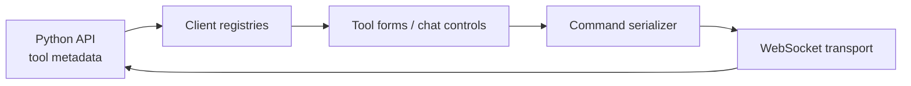

# CAOS Client — Developer Crash Course

A guided introduction to the CAOS (Vision Agent Operative System) web application. Read the chapters in order, then return to them as a reference. The goal is to understand **what each subsystem does, where it lives, and why it works that way**.

## Chapters

| Chapter | Topic | Focus |
|---|---|---|
| [01](01-react-nextjs-primer.md) | React & Next.js primer | Components, hooks, App Router, server/client boundaries |
| [02](02-architecture-and-layout.md) | Architecture & repo layout | Routes, features, shared code, workspace chrome |
| [03](03-auth-and-config.md) | Local session, config & runtime | Development identity, JWT, API access, environment |
| [04](04-data-and-state.md) | Data & state | REST, Redux, registries, WebSockets |
| [05](05-chat-and-tool-ui.md) | Chat & tool UI | Backend-described widgets and CLI serialization |
| [06](06-workflows-and-orchestration.md) | Workflows & orchestration | Running, monitoring, and authoring workflows |
| [07](07-agent-builder.md) | Agent builder | Wizard, validation, agent creation |
| [08](08-testing-and-conventions.md) | Testing & conventions | Checks, test helpers, daily development |

## What CAOS does

CAOS provides a web interface to the agent runtime in the Python API. The frontend lets users interact with agents, execute and inspect workflows, and configure agents and workflows. Model calls and tool execution belong to the backend; the client supplies interaction, visualization, validation, and user feedback.

The central integration idea is **backend-described tool interfaces**. Tool definitions provide UI metadata; the frontend resolves widgets, retains their state, and serializes submissions into supported commands. See [the tool UI chapter](05-chat-and-tool-ui.md) and the repository's `ui-widget-registry.md` for the current contract.



## Getting started

```bash
npm install
npm run dev
```

The existing dev script serves the app on port **4000**. Configure the API endpoint and local session according to the root `README.md` and your installed local-token implementation. Do not assume an external identity provider or a fixed development JWT environment variable name.

## Sources of truth

- Root `README.md` — setup, commands, and actual environment variables.
- `AGENTS.md` — engineering guidelines for OpenCode.
- `DESIGN_SYSTEM.md` and `.opencode/skills/CAOS-design-system/SKILL.md` — UI standards and implementation workflow (when present).
- `ui-widget-registry.md` — authoritative tool UI contract.

The chapter paths describe the existing architecture; verify actual files and exported APIs before changing code.
